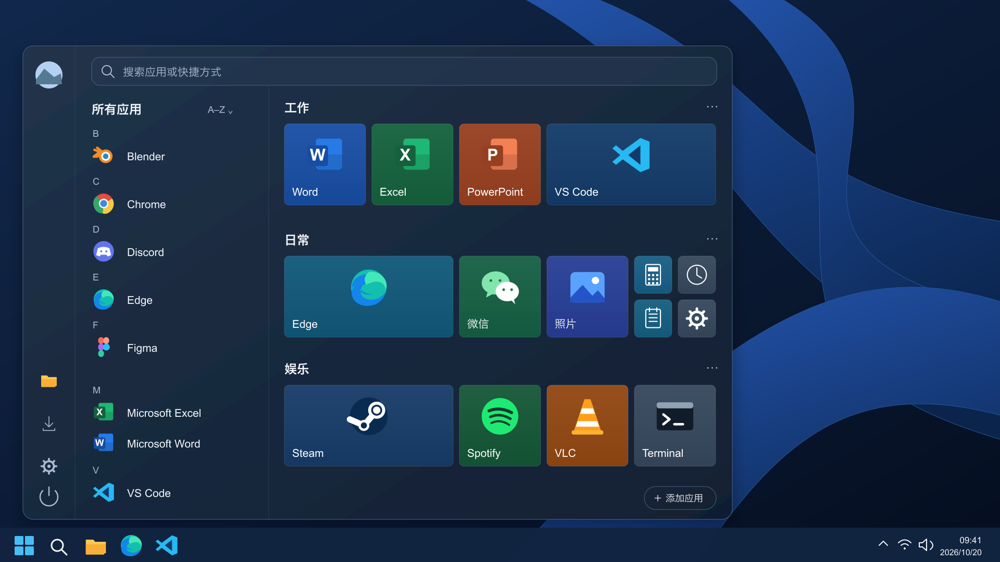

# XDStarter

**让 Windows 11 的开始菜单，重新按你的习惯展开。**

XDStarter 是一款面向 Windows 11 的自定义磁贴开始菜单项目：保留 Windows 10 的应用列表与磁贴分组，结合 Windows 11 的现代视觉，支持整理常用应用、键盘搜索与快速启动。

> 当前处于工程原型阶段。Qt Quick 原型已实现真实应用目录、系统图标、启动与固定/取消固定、三档磁贴编辑，以及布局与主题保存恢复。无边框菜单已接入快捷栏、圆形头像、软件图标、托盘恢复与外部焦点收起，并采用自绘单层圆角、边框、阴影及隐藏阶段定位。本轮 [#22](https://github.com/xiaodaozhi/xdstarter/issues/22) 增加默认关闭、可显式启用及暂停的单独 Win 键唤起原型，系统开始按钮仍保持原生入口。构建、自动检查和实际 Windows 窗口证据按版本记录于[测试记录](docs/technical/testing.md)，历史结果不替代本轮验收。搜索、分组管理与其余系统接管仍待开发，尚未提供可安装的软件。下面展示的是设计稿。



[浅色设计稿](docs/design/mockups/v2/xdstarter-desktop-light-v2.png) · [磁贴尺寸规范](docs/design/mockups/v2/xdstarter-tile-grid-v2.png) · [完整设计资产](docs/design/README.md)

当前设计稿为 v2 修订 2.1，侧栏使用统一线描图标与圆形头像。图中的开始按钮左对齐为历史画布约定；按本轮用户要求，运行时可见面板距工作区左侧和底部任务栏统一为 8 DIP，不随按钮识别结果切换位置。[开发素材](docs/design/assets/README.md)提供深浅主题、多缩放透明 PNG/SVG、三档磁贴底图和 [Windows 多帧软件图标](docs/design/assets/app/xdstarter.ico)，逐项规格见[素材清单](docs/design/assets/manifest.json)。快捷栏、头像及软件图标已接入运行窗口；QML 自绘 12 DIP 圆角、单层边框和阴影，Windows 原生装饰被禁用。外窗透明区仅容纳阴影与圆角，面板保持主题实色；背景材料仍待后续研究，设计稿与实际窗口证据分别记录。

## 我们准备做什么

- 按 Win 键或点击开始按钮打开自定义菜单；保留系统组合键与恢复入口。
- 在应用列表旁固定磁贴，自由调整分组、位置和大小。
- 提供小正方形、标准正方形、宽磁贴三种尺寸，统一间隙，精确对齐。
- 支持中文、拼音及英文应用搜索，首版保持本地运行。
- 提供深浅主题、键盘操作和辅助功能支持。

磁贴编辑、应用目录与启动逐步在工程原型中落地，单独 Win 键已提供可选开启的局部原型；搜索与开始按钮接管等目标继续按 Issues 推进。实际验证范围与未验收环境以测试记录为准。

## 技术方向

**Qt Quick / QML + C++20 + CMake**。产品首先面向 Windows 11 x64；通用界面和布局逻辑可在 macOS 开发验证，Windows 系统集成单独实现。技术选择见 [ADR-0001](docs/technical/adr/0001-qt-quick.md)，与 xdzip 一致的正式构建工具基线见 [ADR-0002](docs/technical/adr/0002-toolchain-baseline.md)。

磁贴逻辑尺寸为 48×48、104×104、216×104 DIP，间隙 8 DIP。布局数据、界面渲染和 Win32 集成保持清晰边界。

## 参与项目

- [提出需求](https://github.com/xiaodaozhi/xdstarter/issues/new?template=feature.yml)
- [报告 Bug](https://github.com/xiaodaozhi/xdstarter/issues/new?template=bug.yml)
- [查看全部任务](https://github.com/xiaodaozhi/xdstarter/issues)
- [查看阶段里程碑](https://github.com/xiaodaozhi/xdstarter/milestones)
- [贡献指南](CONTRIBUTING.md)

需求讨论、任务进度、Bug 复现与验收统一记录在 GitHub Issues 和关联 PR 中。文档保存稳定规格与决策，进度以 GitHub 为准。

## 文档与本地检查

[文档导航](docs/README.md)包含产品需求、交互设计、技术架构、开发规范、测试与发布流程。

文档和设计资产检查：

```sh
python3 scripts/check_repository.py
```

无 Qt 的核心构建和测试（需 C++20 编译器、CMake 3.25+ 和 Ninja）：

```sh
cmake --preset core-debug
cmake --build --preset core-debug
ctest --preset core-debug
```

正式工具版本由本项目 [toolchain.json](toolchain.json) 声明，与 xdzip 已核实的 Windows 构建环境对齐：Qt 6.8.2、MSVC 19.29.30153.0/v142、Windows SDK 10.0.19041.0、Python 3.12.13、CMake 4.4.4、Ninja 1.13.2。项目拥有自己的工具和 Qt 缓存；已有相同 SDK 可作为下载缓存复用。MSVC 2022 CI 是另行标记的附加兼容检查。

```powershell
# Python 参数需指向声明的 Python 3.12.13；首次获取项目工具和 Qt。
./scripts/build-windows.ps1 -InstallTools -Python python -Preset app-release -Fresh
# 使用隔离文件验证，避免改变日常布局。
$env:PATH = "$PWD/build/Qt/6.8.2/msvc2022_64/bin;$env:PATH"
& ./build/app-release/bin/xdstarter.exe --layout-file "$PWD/build/manual-layout.json"
```

普通首次启动显示空的“常用应用”分组，后台读取当前用户／公共开始菜单和打包应用。在“所有应用”中单击或按 Enter 启动；点击“固定”或右键／Shift+F10 选择目标分组，以标准尺寸固定到首个空位。再次固定同一应用不会重复创建磁贴；磁贴右键菜单可取消固定，不会卸载应用。窗口较窄时通过“所有应用／返回磁贴”切换视图。

左侧圆形头像打开账户设置，文档、下载和设置打开对应的受控系统入口；电源图标打开文字菜单，提供 Win 键唤起启用/暂停和“退出 XDStarter”，系统关机、重启与注销尚未启用。动作成功后收起，失败保留窗口并显示原因。右上角“收起菜单”按钮和 Esc 提供无标题栏时的键盘/鼠标入口。窗口获得焦点后，点击其他应用或桌面、切换应用会收起；内部菜单不被当作外部窗口，拖拽期间延后检查，外部收起不退出编辑模式或撤销已提交布局。托盘可用时收起后进程保留，可从托盘再次显示或退出；托盘不可用时最小化以保留任务栏恢复入口。唤起仅读取目标显示器、工作区和任务栏 DPI，不等待开始按钮识别。

每次启动默认关闭 Win 键唤起，不随布局恢复。支持环境且托盘可用时，可从电源菜单或托盘显式启用，单独按下并释放 Win 键切换菜单；托盘另提供暂停/恢复入口。暂停、失败或退出停止接管，托盘恢复也不自动重新启用。系统开始按钮始终保持原生入口，Win 组合键沿原始输入路径放行；本地 Windows 11 的启用条件不等于完整兼容保证，实际物理按键、组合键和恢复范围以本轮测试记录为准。

进入“编辑布局”后拖拽磁贴，或使用 Ctrl+方向键移动一格；右键或 Shift+F10 打开三档尺寸菜单。非法落点保留原布局，Esc 先关闭子菜单或取消拖拽，再退出编辑、收起菜单。外部收起会关闭子菜单并取消未提交拖拽，重新显示时恢复可操作焦点。布局与深浅主题在编辑后自动合并保存，也可点击“保存布局”；再次启动使用同一文件恢复。普通启动默认使用用户应用数据目录；`--smoke-test` 使用三组样例，不连接真实目录、桌面动作、托盘或定位服务，也不读写布局文件。旧样例配置可以继续读取，样例磁贴不会启动应用。

完整命令与支持边界见[开发环境](docs/technical/development.md)、[测试策略](docs/technical/testing.md)。进度与证据见 [#4 工程](https://github.com/xiaodaozhi/xdstarter/issues/4)、[#5 几何](https://github.com/xiaodaozhi/xdstarter/issues/5)、[#7 应用目录与启动](https://github.com/xiaodaozhi/xdstarter/issues/7)、[#9 编辑](https://github.com/xiaodaozhi/xdstarter/issues/9)、[#10 保存恢复](https://github.com/xiaodaozhi/xdstarter/issues/10)、[#14 设计接入与桌面恢复](https://github.com/xiaodaozhi/xdstarter/issues/14)、[#15 无边框菜单与焦点](https://github.com/xiaodaozhi/xdstarter/issues/15)、[#16 统一边距与自绘外观](https://github.com/xiaodaozhi/xdstarter/issues/16)、[#22 单独 Win 键原型](https://github.com/xiaodaozhi/xdstarter/issues/22)；设计重建方法见[设计资产说明](docs/design/README.md)。

## 许可

项目代码与原创设计资产的发布许可证尚待项目所有者确定，暂未授予通用开源许可。Qt 及其他第三方组件遵循各自许可证；设计稿中的第三方应用图标为视觉示意。详见[许可与依赖决策](docs/governance/licensing.md)。
